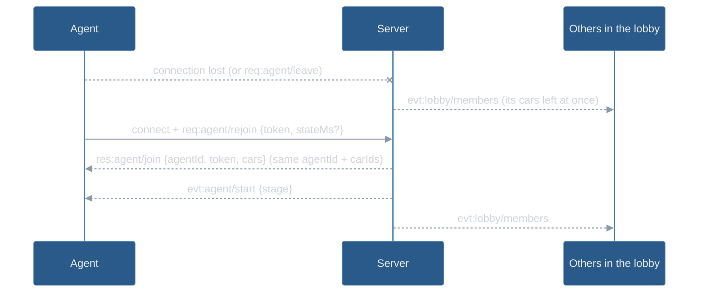

# WebSocket Flow

Server on `localhost:8080` (HTTP API on the same port). The hosted server:
`wss://<domain>/ws`, behind basic auth (agents send an `Authorization`
header; `docs/agent-protocol.md`, "Connecting"). One subprotocol:
`formulai`. The server owns the game; it pushes state to agents / players
and frames to viewers. Types: `server/src/protocol/` (identical copy in
`app/src/protocol/`). For agent authors: `docs/agent-protocol.md`.

## Message Envelope

```typescript
{ ns: string, action: string, data?: any, v?: number }
```

- `ns` prefix: `req:` (request), `res:` (response to it), `evt:` (event,
  unsolicited)
- Domains: `lobby`, `agent`, `player`, `view`, `system`
- One connection can be an agent, a player and a viewer at the same time
  (each at most once; leave before joining another lobby). `evt:system/welcome { clientId }` on connect;
  `evt:system/error { reason, ns?, action? }` for a request the server
  can't handle.

## Roles

| Role | Who | Joins with | Gets |
|---|---|---|---|
| Agent | an AI (no App needed), 1 or more cars | `req:agent/join` | `evt:agent/state` every `stateMs` it chose (own cars) |
| Player | the App's keyboard car (Player mode) | `req:player/join` | `evt:player/state` every tick (its car) |
| Viewer | the App watching a lobby | `req:view/watch` | `evt:view/track` + `evt:view/frame` (+ `times`) |

---

## Lobby, join, watch

```mermaid
%%{init: {'theme': 'base', 'themeVariables': {'background': 'transparent', 'primaryColor': '#2a5a8a', 'primaryTextColor': '#e0e0e0', 'primaryBorderColor': '#4a7aaa', 'lineColor': '#8899aa', 'signalColor': '#8899aa', 'signalTextColor': '#d0d4d8', 'noteTextColor': '#d0d4d8', 'noteBkgColor': '#1e2a38', 'noteBorderColor': '#4a7aaa', 'actorBkg': '#2a5a8a', 'actorTextColor': '#e8ecf0', 'actorBorder': '#4a7aaa', 'labelTextColor': '#e0e0e0', 'loopTextColor': '#e0e0e0', 'labelBoxBkgColor': '#2a5a8a', 'labelBoxBorderColor': '#4a7aaa', 'activationBkgColor': '#1e2a38', 'activationBorderColor': '#4a7aaa'}}}%%
sequenceDiagram
    participant A as Agent
    participant S as Server<br/>(Node.js :8080)
    participant V as Viewer<br/>(App /lobbies/:id)

    A->>S: connect(formulai)
    S-->>A: evt:system/welcome {clientId}

    rect rgb(20, 50, 28)
        Note over A,V: Lobby (or the App: /lobby/create, /session/editor)
        A->>S: req:lobby/create {session, fast?}
        S-->>A: res:lobby/create {lobbyId} | createError {reason}
        A->>S: req:lobby/list
        S-->>A: res:lobby/list {lobbies: [LobbySummary]}
        A->>S: req:lobby/delete {lobbyId} (only an empty lobby)
        S-->>A: res:lobby/delete {lobbyId} | deleteError {reason}
    end

    rect rgb(40, 25, 60)
        Note over A,V: Join (the race starts at the first join)
        A->>S: req:agent/join {lobbyId, name?, cars: [{name, kart}], stateMs?}
        S-->>A: res:agent/join {agentId, token, cars: [{carId, name, kart}], stateMs}
        S-->>A: evt:agent/start {stage}
        S-->>A: evt:lobby/members {lobbyId, members}
        S-->>V: evt:lobby/members {lobbyId, members}
    end

    rect rgb(20, 40, 65)
        Note over A,V: Watch (follow a client or a stage)
        V->>S: req:view/watch {lobbyId, follow?: {client} | {stage}}
        S-->>V: evt:view/track {RenderTrack} (only when the layout changes)
        S-->>V: evt:view/times {stage, karts} (stage change / list change)
        S-->>V: evt:view/frame {tick, key, cars, followed, hud} 20/s (every 3rd tick; the lobby's own player: every tick)
    end
```

- `LobbySummary`: `{ id, session: { name, displayName, cars }, mode,
  autoAdvance, fast, stages, stageList: [StageInfo], members: [{ carId,
  name, kart, kind, ownerId, client, stage }] }` (`client`: the agent's
  join `name`, default `agent <id[0:6]>`; a player's name).
- `evt:lobby/members` goes to every owner and viewer of the lobby on a
  join / leave and when a car's stage changes.
- Viewer frames: only the cars on the viewed stage; `followed { carId,
  ownerId, stage, kart }`; `hud` null when no followed car runs. Re-send
  `req:view/watch` to change what you follow; `req:view/stop` ends it.
- Followed car (`Lobby.view`): a client → its front car that isn't
  crashed (`car.hasCollision`) or paused, all crashed → the car shown last
  (`Viewer.carId`); a stage → its leader (crashed or not). Front = more
  laps, then lower `lapDistance`, then (behind the start line, all at 1)
  nearer the start line.
- A `fast` lobby refuses `req:player/join` (agents only).

---

## One tick

```mermaid
%%{init: {'theme': 'base', 'themeVariables': {'background': 'transparent', 'primaryColor': '#2a5a8a', 'primaryTextColor': '#e0e0e0', 'primaryBorderColor': '#4a7aaa', 'lineColor': '#8899aa', 'signalColor': '#8899aa', 'signalTextColor': '#d0d4d8', 'noteTextColor': '#d0d4d8', 'noteBkgColor': '#1e2a38', 'noteBorderColor': '#4a7aaa', 'actorBkg': '#2a5a8a', 'actorTextColor': '#e8ecf0', 'actorBorder': '#4a7aaa', 'labelTextColor': '#e0e0e0', 'loopTextColor': '#e0e0e0', 'labelBoxBkgColor': '#2a5a8a', 'labelBoxBorderColor': '#4a7aaa', 'activationBkgColor': '#1e2a38', 'activationBorderColor': '#4a7aaa'}}}%%
sequenceDiagram
    participant A as Agent(s)
    participant P as Player (App)
    participant S as Server (LobbyGame + Lobby)
    participant V as Viewer(s)

    rect rgb(20, 40, 65)
        Note over A,V: Real time: a step every 1/60 s
        S->>S: step: physics, collision, rays, checkpoints, laps
        S-->>A: evt:agent/state {tick, cars: [{carId, ...GameState}]} (every stateMs, per agent)
        S-->>P: evt:player/state {tick, car}
        S-->>V: evt:view/frame
        A->>S: req:agent/controls {tick, cars: [{carId, forward, backward, steering, brake}]} (pedals 0..1)
        P->>S: req:player/controls {forward, backward, steering, brake} (while the ramped keys change)
        Note over S: controls apply from the next step; the race doesn't wait for an agent (states on its fixed schedule, answered or not)
        Note over A,P: tick = the client's own (Owner.tickBase): 0 at the first step after its join / rejoin / a restart
    end

    rect rgb(60, 45, 20)
        Note over A,V: Fast training (fast lobby): lockstep
        S->>S: step N
        S-->>A: evt:agent/state {tick: N}
        S-->>V: evt:view/frame (at most 20 per second)
        A->>S: req:agent/controls {tick: N} (EVERY agent)
        S->>S: step N+1 at once (no cap)
        Note over A,S: an agent silent 5 s → evt:system/error, connection closed (4000), its cars leave
    end
```

---

## Restart and next stage

```mermaid
%%{init: {'theme': 'base', 'themeVariables': {'background': 'transparent', 'primaryColor': '#2a5a8a', 'primaryTextColor': '#e0e0e0', 'primaryBorderColor': '#4a7aaa', 'lineColor': '#8899aa', 'signalColor': '#8899aa', 'signalTextColor': '#d0d4d8', 'noteTextColor': '#d0d4d8', 'noteBkgColor': '#1e2a38', 'noteBorderColor': '#4a7aaa', 'actorBkg': '#2a5a8a', 'actorTextColor': '#e8ecf0', 'actorBorder': '#4a7aaa', 'labelTextColor': '#e0e0e0', 'loopTextColor': '#e0e0e0', 'labelBoxBkgColor': '#2a5a8a', 'labelBoxBorderColor': '#4a7aaa', 'activationBkgColor': '#1e2a38', 'activationBorderColor': '#4a7aaa'}}}%%
sequenceDiagram
    participant A1 as Agent 1
    participant A2 as Agent 2
    participant S as Server

    rect rgb(60, 25, 25)
        Note over A1,S: Restart: only your own listed cars
        A1->>S: req:agent/restart {cars: [{carId, startPosition?, startSpeed?}]}
        S->>S: those cars: stage restarted, in their grid box (standing) or at a random place (loops) at startSpeed
        S-->>A1: evt:agent/restarted {carIds} (after the next step)
    end

    rect rgb(40, 25, 60)
        Note over A1,S: Next stage — training (default): your cars only
        A1->>S: req:agent/nextStage {completed: true | false}
        S-->>A1: evt:agent/stage {stage}
        Note over A2: stays on its stage
    end

    rect rgb(20, 50, 28)
        Note over A1,S: Next stage — race: the whole lobby
        A1->>S: req:agent/nextStage {completed}
        S-->>A1: evt:agent/stage {stage}
        S-->>A2: evt:agent/stage {stage}
    end

    Note over A1,S: every stage left with completed: true → evt:agent/completed (to the clients on that progress)
```



- Player: `req:player/restart` (R / Reset) restarts its car; Player mode's
  lobby is `autoAdvance` — a finish moves on by itself; the end →
  `evt:player/completed { stageTimes, totalTime }`.
- `nextStage` needs a boolean `completed` (else `evt:system/error`).
  Skipped stages come round again; a client that joined with `repeat:
  true` (training) never completes.

---

## Leaving, dropping, rejoining



- Training: the rejoin continues at the agent's own stage. Race: the
  lobby's stage (the last one out paused it → the race starts over).
- If the agent is still on another connection, the new one takes it over.
- A lobby nobody drives or watches for `EMPTY_LOBBY_SECONDS` (600) is
  deleted — its tokens stop working; a single-player lobby as soon as its
  player is gone. App on a lost connection: "Start again" (Player mode) /
  "Reconnect" (viewer).

---

## Server handler map (`FormulaiServer.handle`)

| Message | From | Does | Answers / events |
|---|---|---|---|
| `req:lobby/list` | anyone | — | `res:lobby/list` |
| `req:lobby/create` | anyone | new `Lobby` (session name or whole session; `autoAdvance`, `fast`) | `res:lobby/create` / `createError` |
| `req:lobby/delete` | anyone | `deleteLobby` — only an empty lobby (no agent / player; viewers stop watching); its tokens die | `res:lobby/delete` / `deleteError` |
| `req:agent/join` | not yet an agent | cars into the lobby (karts checked; `name` = client name ≤ 40; `stateMs` 16–1000, default 150; `repeat` = training: its own endless, default once through) | `res:agent/join` / `joinError`, `evt:agent/start`, `evt:lobby/members` |
| `req:agent/rejoin` | a token holder | same agent + carIds back (`stateMs` not set → the old one) | as join |
| `req:agent/leave` | agent | its cars leave | `evt:lobby/members` |
| `req:agent/controls` | agent | its listed cars' controls; fast: the tick's answer (its own tick) | — |
| `req:agent/restart` | agent | its listed own cars restart (`cars: [{ carId, startPosition?: 'grid' \| 'random', startSpeed?: 0..1 }]`; random = loop layouts, one-way → grid) | `evt:agent/restarted` after the next step |
| `req:agent/pause` | agent | its listed own cars freeze in place (every value kept; left out of the state; grey to viewers) | — |
| `req:agent/resume` | agent | its listed own paused cars carry on | `evt:agent/state` after the next step (off schedule) |
| `req:agent/nextStage` | agent | training: its cars move on; race: everyone | `evt:agent/stage` (that progress' agents); `evt:agent/completed` |
| `req:player/join` | not yet a player | one keyboard car (refused in a fast lobby) | `res:player/join { playerId, carId, handling }` (the kart's values for the keyboard aids) / `joinError` |
| `req:player/controls` | player | its car's controls | — |
| `req:player/restart` | player | its car restarts | — |
| `req:player/leave` | player | its car leaves | `evt:lobby/members` |
| `req:view/watch` | anyone | watch / change follow | `evt:view/track`, `times`, `frame`; `res:view/watchError` |
| `req:view/stop` | viewer | stop watching | — |
| unknown | — | — | `evt:system/error` |

## HTTP API (same port, `server/src/httpApi.ts`)

| Route | Access | What |
|---|---|---|
| `GET /api/sessions`, `GET /api/sessions/:name` | open | every session (in the server's S3 bucket) |
| `PUT` / `DELETE /api/sessions/:name` | open | save / delete any session |
| `GET /api/karts` | open | kart classes |
| `GET /api/ping` | open | `{ ok: true }` at once — latency check |
| `GET /api/tracks/layouts` | open | track + layout names, loop, expected lap times |
| `GET /api/tracks` | `X-Editor-Password` | drafts + published files |
| `GET` / `PUT` / `DELETE /api/tracks/<drafts\|published>/<file>.json` | `X-Editor-Password` | read / save (publish = live for new lobbies) / delete (published in use → 409) |
| `GET /api/backgrounds`, `GET /api/backgrounds/<file>` | open | trace backgrounds (list / the image) |
| `PUT` / `DELETE /api/backgrounds/<file>` | `X-Editor-Password` | upload (≤ 20 MB, png / jpg / webp) / delete (used by a track → 409) |

Wrong password → 401; no `EDITOR_PASSWORD` on the server → 503.
